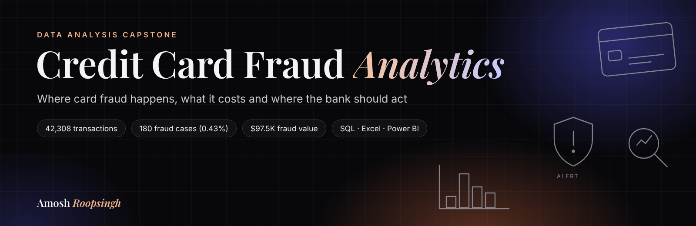
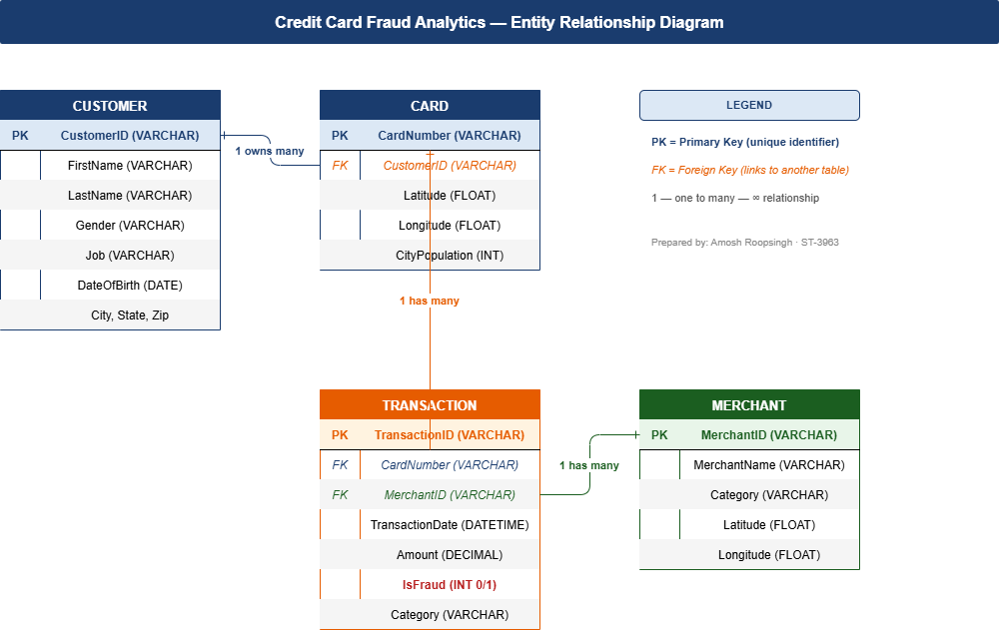
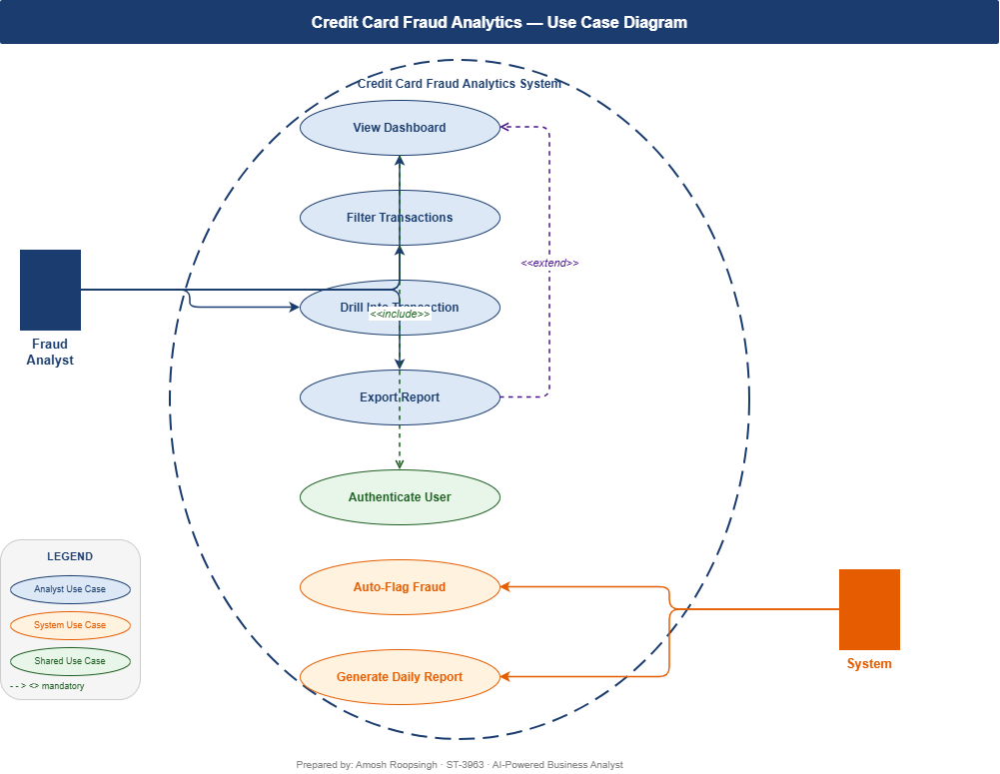

  

  
  
  
  
  

> **Course project** (business analysis programme capstone). The bank is a scenario and the transaction data is a public practice dataset, not real customer data.

## The question
How much fraud is in the bank's card transactions, where does it happen and what does it cost, so the bank knows where to act first?

## The problem
- **42,308 card transactions** from December 2019, with fraud mixed in among normal spending.
- The bank had no single view of fraud by category, location or time.
- The raw data had **import problems**: date formats and card numbers in the wrong data type.

## The solution
A Business Requirements Document to agree the questions, an ERD and use case diagram for the data, **SQL** to load and query the transactions, **Excel** (COUNTIF, SUMIF, AVERAGEIFS) to check the analysis, and a **3-page Power BI dashboard** for stakeholders.

## At a glance

| | |
|---|---|
| **Transactions analysed** | 42,308 (total value about $2.97M) |
| **Fraud cases** | 180 (0.43% of transactions) |
| **Fraud value** | $97,540.81 |
| **Average fraud transaction** | $542 |
| **Deliverables** | BRD, ERD, use case diagram, SQL script, 3-page dashboard |

## Key findings

| # | Finding | Evidence |
|:---:|---|---|
| 1 | **Fraud is rare by count but costly by value** | 0.43% of transactions, but about 3.3% of total value ($97.5K of about $2.97M). |
| 2 | **Fraudulent transactions are much larger than normal ones** | Average fraud transaction $542, against about $70 across all transactions. |
| 3 | **Online shopping carries the most fraud value** | "Shopping Net" has the highest fraud amount, roughly twice the next category ("Shopping POS"). |
| 4 | **The most frequent fraud is in-store grocery** | "Grocery POS" has the largest share of fraud cases (15.37%), even though its value is lower. |
| 5 | **Fraud rises late in the month** | Daily fraud cases peak around days 28 to 30 of December. |

## Recommendations
1. **Add extra checks on high-value online transactions**, where most fraud value sits.
2. **Flag unusually large transactions** for review: fraud averages about 8 times a normal transaction.
3. **Increase monitoring at month end and over the holiday period**, when fraud cases peak.

## Limitations
- One month of data (December 2019), so seasonal effects cannot be separated from normal patterns.
- The dataset is a practice dataset, so patterns may not reflect a real bank.
- Findings 3 and 5 are read from the dashboard charts and are approximate.

## Dashboard

<b>Show all three pages</b>

 

## Data model and requirements

## What I did
1. **Gathered requirements** and wrote a Business Requirements Document.
2. **Modelled the data:** designed the ERD and a use case diagram.
3. **Loaded the data into SQL** and fixed import problems (date formats and card number data types).
4. **Analysed it in Excel** using COUNTIF, SUMIF and AVERAGEIFS.
5. **Built a 3-page Power BI dashboard** for stakeholders.
6. **Presented the findings** in the STAR format.

## Files

| File | What it is |
|---|---|
| `Credit_Card_Fraud - Business requirement Document.docx` | Business Requirements Document |
| `CREDIT_CARD_FRAUD SQL.sql` | SQL script: load and analysis queries |
| `Credit_Card_Fraud_Dashboard.pbix` | The Power BI dashboard |
| `Credit_Card_Fraud_Dashboard 1-3.png` | Screenshots of each page |
| `Credit_Card_Fraud_ERD.png`, `Credit_Card_Fraud_UseCase.png` | Data model and use case diagram |

---

  <b>Amosh Roopsingh</b> · Business Analyst · Birmingham, UK  
  <a href="https://www.linkedin.com/in/amosh-roop-singh-business-analyst/">LinkedIn</a> ·
  <a href="https://github.com/amoshr">GitHub</a> ·
  <a href="https://amoshr.github.io/">Portfolio</a>

