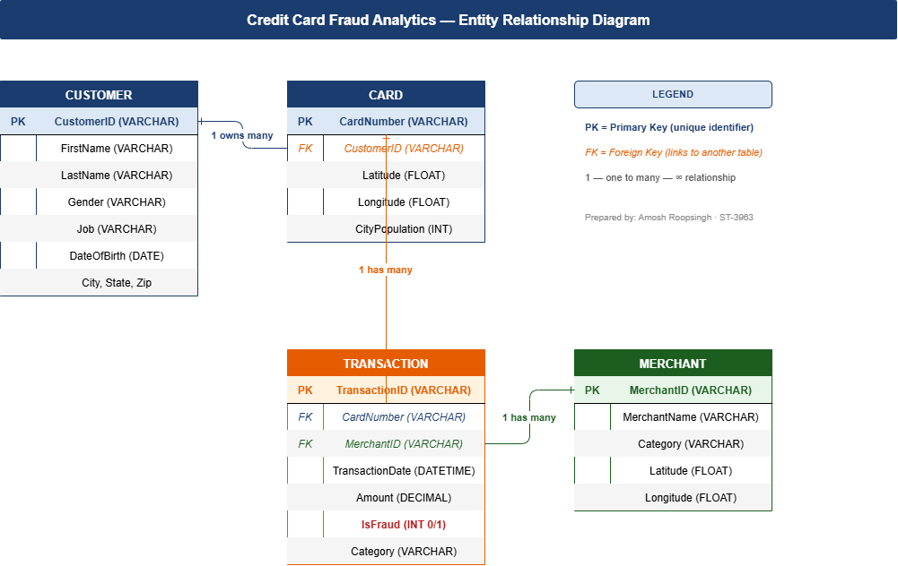
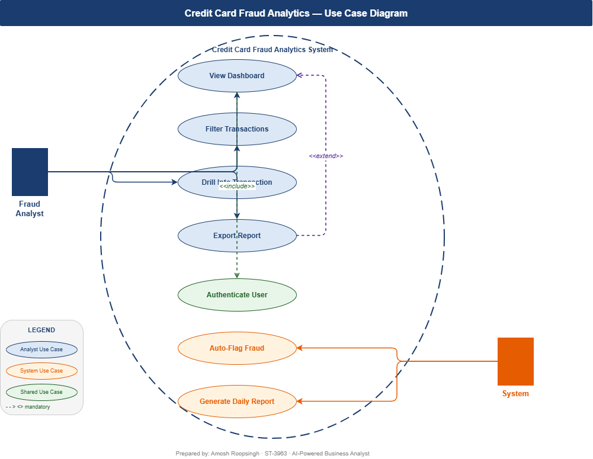

# Credit Card Fraud Analysis

**Business analysis capstone | SQL · Excel · Power BI**

## Business problem
A bank needs to understand how much fraud is in its card transactions, where it happens and what it costs, so it can decide where to act. This project analyses a transaction dataset end to end, from requirements and data model to dashboard and presentation.

## Key numbers
| Measure | Result |
|---|---|
| Transactions analysed | 42,308 |
| Fraud cases found | 180 |
| Fraud rate | 0.43% |
| Fraud value | $97,540.81 |

## Tools
- **SQL:** loading and querying the data
- **Excel:** COUNTIF, SUMIF and AVERAGEIFS formulas for the analysis
- **Power BI:** a 3-page dashboard
- **draw.io:** ERD and use case diagram
- **Word:** Business Requirement Document (BRD)

## What I did
1. **Gathered requirements** and wrote a Business Requirement Document.
2. **Modelled the data:** designed the ERD and a use case diagram.
3. **Loaded the data into SQL** and fixed import problems (date formats and card number data types).
4. **Analysed it in Excel** using COUNTIF, SUMIF and AVERAGEIFS.
5. **Built a 3-page Power BI dashboard** for stakeholders.
6. **Presented the findings** in the STAR format.

<!-- Add your 2-3 main findings from the dashboard here -->

## Dashboard

## Data model and requirements

##
